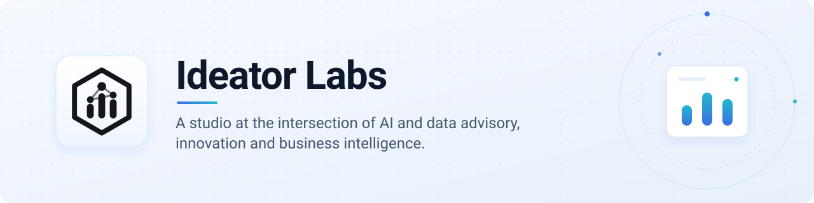

  
  
  

**Ideator Labs** is a studio at the intersection of AI and data advisory, innovation and business intelligence. We help businesses see what changed in their numbers, why it changed and what to do next, and we turn that work into software: our own products, and open-source code anyone can use.

## Products

**[FurniTrail](https://ideatorlabs.github.io/products/furnitrail/)** · *From browsing to belonging.* 
For furniture showrooms. Turns visitors into buyers: each buyer gets one page in the showroom's name with the pieces they liked, a proposal they can accept, then their order and delivery. Every morning the team knows who needs them.

**[PollenRev](https://ideatorlabs.github.io/products/pollenrev/)** · *Sales software.* 
Finds leads, writes outreach and proposals, and keeps every deal in one pipeline.

## Open source

| Project | What it does | |
|---|---|---|
| [**CORTEX**](https://github.com/ideatorlabs/cortex) | Framework for AI agents and the tools they call. Includes [YAMCP](https://github.com/ideatorlabs/cortex/tree/main/yamcp), a Model Context Protocol (MCP) tool server over HTTP, WebSocket or the command line. | [repo](https://github.com/ideatorlabs/cortex) |
| [**Greenline**](https://github.com/ideatorlabs/greenline) | WhatsApp Business Cloud API engine for many businesses from your own server: 24-hour window with template fallback, signed webhooks, STOP/START, cost per message. | [docs](https://ideatorlabs.github.io/greenline/) |
| [**TillSync**](https://github.com/ideatorlabs/tillsync) | Pulls customers and bills from POS systems, JSON APIs, Google Sheets and CSV or Excel into one clean shape, with explained column mapping. | [docs](https://ideatorlabs.github.io/tillsync/) |
| [**Nudgewright**](https://github.com/ideatorlabs/nudgewright) | Writes one short, personal customer message from the facts you really have, within fixed guardrails, and says why. | [docs](https://ideatorlabs.github.io/nudgewright/) |
| [**Faultbell**](https://github.com/ideatorlabs/faultbell) | One clean alert per problem when a Python service or cron job fails, in Discord, Slack, Teams, Google Chat, Telegram, PagerDuty or email, plus a server watch. | [docs](https://ideatorlabs.github.io/faultbell/) |
| [**Leadbell**](https://github.com/ideatorlabs/leadbell) | Website lead capture with stored consent, a spam trap and rate limiting, and one card per sign-up, lead or payment in Discord, Slack or any webhook. | [repo](https://github.com/ideatorlabs/leadbell) |

The Python packages run on Python 3.10+, are Apache-2.0 licensed and are tested on every change. More on the [open-source page](https://ideatorlabs.github.io/open-source/).

## How we work

- **Advisory.** We look at how a business runs and where AI and data can save time or money, and we say plainly when they can't.
- **Business intelligence.** Reporting that answers what changed, why, and what to do next.
- **Products.** What works in practice becomes software we build and run ourselves.

## Contact

**[ideatorlabs.ai@gmail.com](mailto:ideatorlabs.ai@gmail.com)** · [+91 73269 70981](tel:+917326970981) · [ideatorlabs.github.io](https://ideatorlabs.github.io)

© 2026 Ideator Labs

